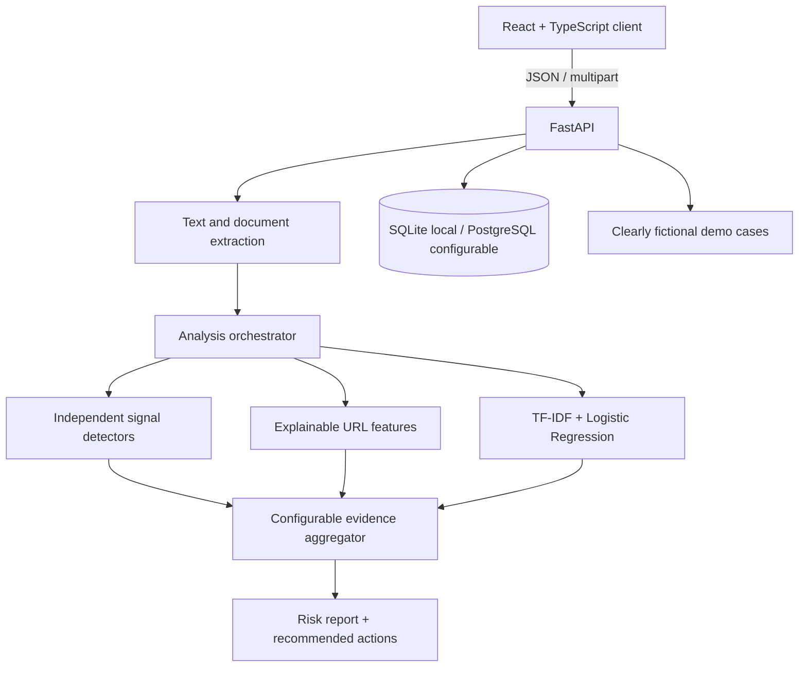

# ScamShield Architecture

## System flow



## Repository structure

```text
.
├── ARCHITECTURE.md
├── README.md
├── .env.example
├── .gitignore
├── backend/
│   ├── app/
│   │   ├── main.py                 # API, validation, upload endpoints
│   │   ├── config.py               # Environment-backed settings and weights
│   │   ├── database.py             # SQLite/PostgreSQL session setup
│   │   ├── models.py               # Persisted analysis records
│   │   ├── schemas.py              # Request/response contracts
│   │   ├── services/
│   │   │   ├── analysis.py         # Layer orchestration and scoring
│   │   │   ├── signals.py          # Social engineering/evidence detectors
│   │   │   ├── urls.py             # Safe, local URL feature checks
│   │   │   ├── extraction.py       # PDF/OCR extraction
│   │   │   └── classifier.py       # Train/evaluate/load sklearn pipeline
│   │   └── data/
│   │       ├── demo_cases.json     # Fictional, labeled demo examples
│   │       └── synthetic_training.csv
│   ├── tests/
│   ├── train_model.py
│   └── requirements.txt
└── frontend/
    ├── index.html
    ├── package.json
    ├── vite.config.ts
    ├── tsconfig*.json
    └── src/
        ├── App.tsx
        ├── main.tsx
        ├── index.css
        ├── api.ts
        ├── types.ts
        └── components/
```

## Trust and deployment boundaries

- The model is trained on a small, explicitly synthetic development corpus; its output is a supporting signal, not a real-world accuracy claim.
- Rules emit evidence, not verdicts. No single feature proves fraud; the calibrated result includes an `Unable to Determine` state when content is insufficient.
- URL checks are local and non-invasive. ScamShield does not visit submitted URLs or follow redirects. Reputation lookups require a separately configured approved provider and are omitted when absent.
- PDF text extraction and image OCR run locally. Unsupported, oversized, or unreadable files produce an actionable error instead of a fabricated report.
- Analysis records are stored locally in SQLite by default; `DATABASE_URL` can select PostgreSQL. Authentication and institution-wide deployment are out of scope for this single-user hackathon prototype and must be added before public multi-user deployment.
